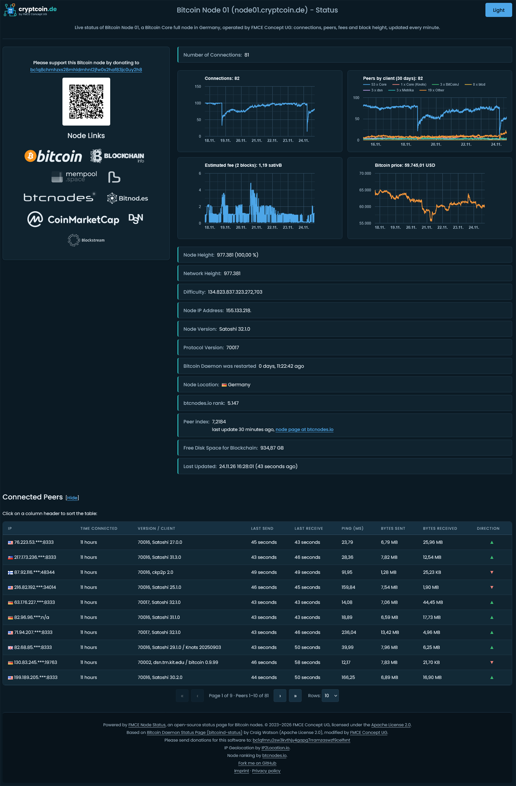
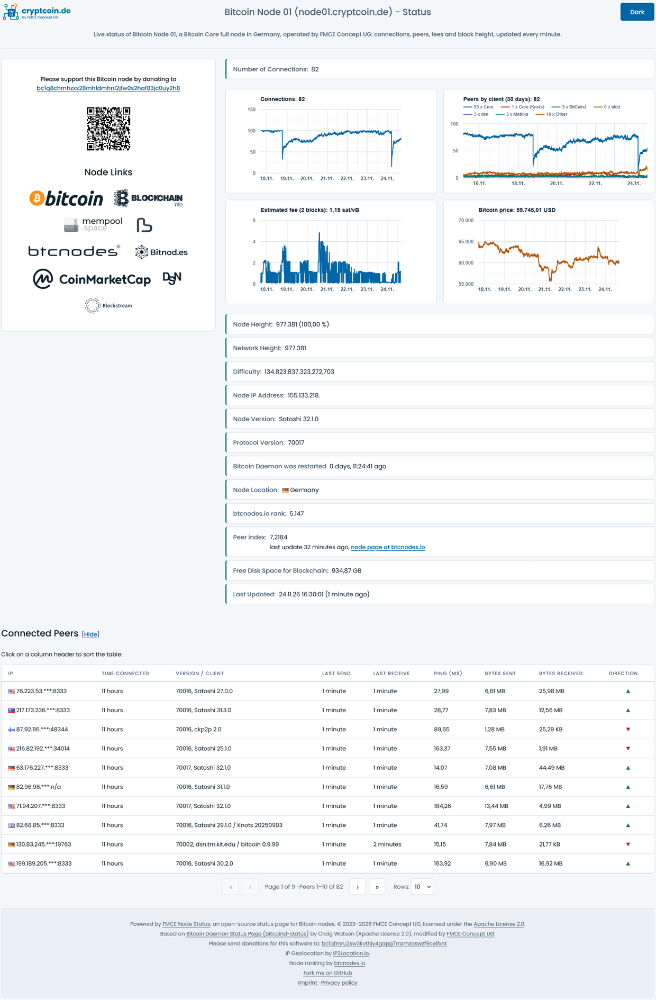

# FMCE Node Status

FMCE Node Status is a status page for your Bitcoin Core node (bitcoind). It is a
modernized and maintained continuation of *Bitcoin Daemon Status Page*
([bitcoind-status](https://github.com/craigwatson/bitcoind-status)) by Craig Watson.

Live demo: https://node01.cryptcoin.de/

| Dark | Light |
|---|---|
|  |  |

## Contents

1. [Features](#features)
2. [Requirements](#requirements)
3. [Installation](#installation)
4. [Collector](#collector)
5. [Configuration](#configuration)
6. [Remote node and local node](#remote-node-and-local-node)
7. [Optional features](#optional-features)
8. [Adding a chart](#adding-a-chart)
9. [Security](#security)
10. [Troubleshooting](#troubleshooting)
11. [Privacy notes for operators](#privacy-notes-for-operators)
12. [Coming from bitcoind-status?](#coming-from-bitcoind-status)
13. [Contributing](#contributing)
14. [Support the project](#support-the-project)
15. [About](#about)
16. [License](#license)

## Features

- Node values: connections, block height (also as a percentage of the network height),
  difficulty, version, protocol version, uptime, free disk space, node location.
- Connected peers in a table with pages and sorting (mouse and keyboard). Peer IP
  addresses can be masked. Tor, I2P and CJDNS peers are marked or can be hidden.
- Charts (Google Charts): connections, peers by client, estimated fee, Bitcoin price
  (BTC/USD). More charts can be added with one definition (see [Adding a chart](#adding-a-chart)).
- Optional: location of peers and node (ip2location.io), rank and Peer Index of the node
  at btcnodes.io.
- Dark and light theme, background refresh without reloading the page.
- No requests to other services while the page is built: a cron job (the collector)
  fetches all data and stores it in `data/`.
- Content Security Policy without `'unsafe-inline'`.

## Requirements

- **PHP 8.0 or newer** is supported, tested with PHP 8.3 to 8.5. PHP 7.x and older are
  not supported. The cURL extension is required, mbstring is recommended.
- **Apache 2.4 only**, with `.htaccess` files allowed (`AllowOverride`). The `.htaccess`
  files block access to `data/`, `php/`, `.git/` and other folders. Without Apache these
  blocks do not work, and peer IPs and internal files can be read by everybody. nginx is
  not supported (yet).
- **A cron job that runs PHP on the command line (PHP CLI).** Shell access is not
  needed; the cron menu of the hosting panel is enough if it runs a command. Hosters
  whose cron jobs can only call a URL are not sufficient.
- A Bitcoin Core node whose RPC interface can be reached from the web server.

## Installation

1. Put the files into the web root: download the ZIP of a release or use `git clone`.
2. Copy `php/config.sample.php` to `php/config.php` and edit it: `RUNTIME_DIR`, the RPC
   access, `canonical_url`, the donation address, the imprint and privacy URLs and the
   display formats. See [Configuration](#configuration).
3. Make `data/` writable for the user that runs the cron job.
4. Add the cron job. It must run as the **web server user** of the site (for example
   `www-data`), otherwise the file permissions in `data/` do not match.
   Call PHP with its full path (check it with `which php`):

   ```
   * * * * * /usr/bin/php /var/www/example/php/collector.php > /dev/null 2>&1
   ```

   A template for `/etc/cron.d/` is `doc/fmce-node-status.sample` (with a user column).
   A file in `/etc/cron.d/` must belong to root, have mode 0644, use LF line endings,
   end with a line break and have no dot in its name.
5. Test it as the web server user:

   ```
   sudo -u www-data php /var/www/example/php/collector.php --force
   sudo -u www-data php /var/www/example/php/collector.php --status
   ```

6. Open the page. Values appear after the first collector run.

The folder `doc/` contains the cron templates and the screenshots; it is blocked for
visitors.

## Collector

`php/collector.php` runs only on the command line (the web server answers 403). Run it
every minute; every data source has its own interval in the config.

| Option | Meaning |
|---|---|
| (none) | run all jobs that are due |
| `--force` | run all enabled jobs now (disabled jobs are listed as `SKIP` with the reason) |
| `--job=fee,peerinfo` | run only these jobs now, also if they are disabled |
| `--status` | show the status of all jobs (no fetching), and a warning if `timezone` is unknown |
| `--view=fee` | show the data file of one job |
| `--clear=fee` | delete the data file of one job |
| `--help` | show the help |

Exit codes: `0` = ok, `1` = at least one job failed, `2` = configuration or usage error.
Every job prints one line: `OK`, `SKIP`, `WAIT` (rate limit, see btcnodes.io) or `ERROR`.

A job runs only while the page shows its data. For example `'display_fee_chart' => false`
switches off the job `fee`, and `'display_free_disk_space' => false` switches off
`diskspace`. A failing source never stops the other jobs, and its old data file stays.

Checks:
- `php php/collector.php --status` as the web server user.
- The modification time of `data/nodestat-collector.state`.
- For a test, write the output to a log file instead of `/dev/null`,
  e.g. `/tmp/fmce-collector.log`.
- `journalctl -u cron --since "10 min ago"` (Debian/Ubuntu) shows errors such as
  "WRONG FILE OWNER" or "INSECURE MODE" for files in `/etc/cron.d/`.

**Page cache:** the page is rebuilt at most every `max_cache_time` seconds
(`data/nodestat-status.cache`). A change of the configuration or a software update makes
the cache invalid automatically. To clear it by hand, delete the file.

Remove cron entries of older versions (`stats.php`, `peercount.php`, `cronjob.sh`,
`cache_*.php`).

## Configuration

All settings are in `php/config.php` (template: `php/config.sample.php`). The column
"Sample" shows the value in `config.sample.php`.

### RPC connection and node address

| Key | Type | Sample | Meaning |
|---|---|---|---|
| `RUNTIME_DIR` (constant) | string | `/path/to/webroot/web` | absolute path of the web root (the folder with `index.php`) |
| `rpc_user` | string | `RPCUser` | RPC user name |
| `rpc_pass` | string | `RPCPass` | RPC password |
| `rpc_host` | string | `xxx.xxx.xxx.xxx` | RPC host of the node |
| `rpc_port` | string | `8332` | RPC port |
| `rpc_ssl` | bool | `false` | use HTTPS for RPC |
| `rpc_ssl_ca` | string/null | `null` | CA file for the RPC certificate |
| `node_ip` | string | `xxx.xxx.xxx.xxx` | public address of the node, shown on the page and used for the node location |

### Donations

| Key | Type | Sample | Meaning |
|---|---|---|---|
| `donation_address` | string | `not_set` | Bitcoin address for donations to your node; `not_set` hides the block |
| `donation_amount` | string | `0.00002` | amount in the QR code |
| `donation_label` | string | `Donating to my bitcoin node.` | label in the QR code |
| `donation_qr_height`, `donation_qr_width` | int | `150` | size of the QR code in pixels |

### Peers

| Key | Type | Sample | Meaning |
|---|---|---|---|
| `display_peer_info` | bool | `true` | show the peer table |
| `display_peer_port` | bool | `true` | show the port of a peer |
| `display_masked_ip` | bool | `true` | mask the last part of peer IPs (Tor and I2P addresses are always masked) |
| `hide_dark_peers` | bool | `true` | hide peers that are not on the public internet: localhost, Tor, I2P, CJDNS |
| `ignore_unknown_ping` | bool | `false` | hide peers without a ping time |
| `peers_to_ignore` | array | `array()` | peer addresses that are never shown |

### Cache, refresh and peer table

| Key | Type | Sample | Meaning |
|---|---|---|---|
| `cache_dir` | string | `RUNTIME_DIR . '/data'` | folder of the data files |
| `geo_cache_file` | string | `…/data/nodestat-geolocation.cache` | file of the geolocation cache |
| `geo_cache_time` | int | `604800` | seconds (7 days) until a peer location is looked up again |
| `use_cache` | bool | `true` | page cache on or off |
| `cache_file` | string | `…/data/nodestat-status.cache` | file of the page cache |
| `max_cache_time` | int | `60` | seconds until the page is rebuilt |
| `refresh_interval` | int | `60` | seconds between background updates of an open page (minimum 30, `0` = off) |
| `refresh_peers_every` | int | `3` | update the peer table only every n-th time |
| `peers_per_page` | int | `10` | peers per page (visitors can change it; `0` = all) |
| `peer_agent_max_length` | int | `40` | maximum characters of a peer's user agent, full text as tooltip (`0` = never shorten) |

### Geolocation

| Key | Type | Sample | Meaning |
|---|---|---|---|
| `geolocate_peer_ip` | bool | `true` | show the country flag of peers |
| `display_ip_location` | bool | `true` | show the location of the node (needs `display_ip`) |

### Page

| Key | Type | Sample | Meaning |
|---|---|---|---|
| `canonical_url` | string | `''` | public URL of the page, best ending with `/`; the logo links here, also needed for `share_image` |
| `img_dir` | string | `RUNTIME_DIR . '/img'` | folder for the QR code image of the donation address; must be the `img/` folder of the web root (if the web server cannot write there, the image is embedded in the page) |
| `site_logo_dark`, `site_logo_light` | string | `img/cryptcoin-de-logo_*.svg` | logo per theme (`''` = no logo) |
| `share_image` | string | `img/og-image_light.jpg` | preview image for links in social media and messengers, 1200 × 630 px (`''` = none) |
| `display_ip` | bool | `true` | show the node address |
| `display_free_disk_space` | bool | `true` | show the free disk space |
| `display_version` | bool | `true` | show the node version |
| `display_protocolversion` | bool | `true` | show the protocol version |
| `display_github_notice` | bool | `false` | show the "Fork me on GitHub" link in the footer |
| `display_max_height` | bool | `true` | show the network height and the node height in percent (blockchain.info) |
| `display_btcnodes_info` | bool | `false` | show the rank and Peer Index at btcnodes.io (see [Optional features](#optional-features)) |
| `intro_text` | string | `This Bitcoin node is running 24/7 …` | text below the title, also the meta description (`not_set` = none) |
| `title_text` | string | `My Bitcoin Node - Status` | title of the page |
| `display_connection_chart`, `display_peer_chart`, `display_fee_chart`, `display_price_chart` | bool | `true` | show the chart (a missing key counts as `true`) |
| `node_links` | array | bitcoin.org, explorers, … | logos with links below the donation block (`name`, `image`, `link`; only http(s) links) |

### Collector

The block `collector` controls `php/collector.php`. Every value is optional; missing
values use the defaults in `php/data_lib.php`.

| Key | Type | Sample | Meaning |
|---|---|---|---|
| `lock_file` | string | `…/data/nodestat-collector.lock` | lock file (only one run at a time) |
| `state_file` | string | `…/data/nodestat-collector.state` | status of all jobs |
| `rpc_timeout` | int | `15` | seconds for the node (all RPC calls run in parallel) |
| `http_timeout` | int | `10` | seconds for blockchain.info, CoinMarketCap, ip2location.io and `free_disk_space_url` |
| `stale_factor` | int | `3` | data counts as outdated after interval × 3 |
| `jobs` | array | see below | one entry per job |

Every job has `enabled` and `interval` (seconds, minimum 60); most have `file`.

| Job | Sample interval | Source | Extra keys |
|---|---|---|---|
| `blockchaininfo` | 60 | RPC `getblockchaininfo` | |
| `networkinfo` | 60 | RPC `getnetworkinfo` | |
| `peerinfo` | 60 | RPC `getpeerinfo` | |
| `latestblock` | 60 | blockchain.info (only with `display_max_height`) | |
| `connections` | 300 | time series from `getnetworkinfo` | `max_age` (604800), `min_data_points` (5) |
| `peercount` | 300 | time series from `getpeerinfo` | `max_age` (2592000), `min_data_points` (10), `extra_nodes` (label => text in the user agent) |
| `fee` | 300 | RPC `estimatesmartfee` | `max_age`, `min_data_points`, `conf_target` (2 blocks), `estimate_mode` (`conservative` or `economical`) |
| `uptime` | 60 | RPC `uptime` (only with `display_node_uptime`) | |
| `diskspace` | 300 | remote file or local disk (only with `display_free_disk_space`) | |
| `geolocation` | 300 | ip2location.io | `max_lookups` (20 new addresses per run), `apikey` (optional) |
| `cmc_price` | 300 | CoinMarketCap | `max_age`, `min_data_points`, `apikey` (`keyless` or your key), `symbols`, `convert` |
| `btcnodes` | 10800 | btcnodes.io (only with `display_btcnodes_info`) | `node_address` (`ip:port`, `''` = from bitcoind), `api_url` |

### Node, uptime and disk space

| Key | Type | Sample | Meaning |
|---|---|---|---|
| `node_is_remote` | bool | `true` | the node runs on another server (only used for the free disk space) |
| `display_node_uptime` | bool | `true` | show the uptime of the node (via RPC) |
| `free_disk_space_url` | string | `https://your_remote.server/bitcoin_node_freespace.txt` | remote: HTTPS URL of the text file written by `save_diskspace.php` |
| `disk_space_mount_point` | string | `.` | local: path of the blockchain disk (relative paths count from the web root) |

### System

| Key | Type | Sample | Meaning |
|---|---|---|---|
| `format_date` | string | `d.m.y` | date format (PHP `date()` letters), e.g. `Y-m-d` or `m/d/Y` |
| `format_time` | string | `H:i:s` | time format; 12 hours: `g:i:s A` |
| `format_decimal_point` | string | `,` | decimal point (international: `.`) |
| `format_thousands_sep` | string | `.` | thousands separator (international: `,`) |
| `format_language` | string | `de` | language of the chart axes, e.g. `en` |
| `timezone` | string | `Europe/Berlin` | time zone of the page; an unknown name falls back to the server default |
| `css_style` | string | `light` | default theme, `light` or `dark` (visitors can switch) |
| `debug` | bool | `false` | show collector error messages on the page (can contain host names) |
| `display_imprint`, `imprint_url` | bool, string | `true`, `https://example.com/imprint` | imprint link in the footer |
| `display_privacy`, `privacy_url` | bool, string | `true`, `https://example.com/privacy` | privacy policy link in the footer |
| `display_cookie_notice` | bool | `true` | small notice about the two technical cookies |
| `admin_email` | string | `email@example.com` | contact address shown on errors (only if valid) |

## Remote node and local node

**Node on another server** (`'node_is_remote' => true`): the uptime comes via RPC, so
nothing has to be installed on the node server for it. For the free disk space:

1. Copy `remote_files/save_diskspace.php` and
   `remote_files/nodestat_remote_config_sample.php` into a folder on the node server and
   rename the sample to `nodestat_remote_config.php`. Set `freespace_drive_name` (mount
   point of the blockchain), `freespace_file_name` (the text file) and `chown_usergroup`.
2. The text file must be reachable via HTTPS from the web server
   (`free_disk_space_url`; the TLS certificate is checked).
3. Add a cron job on the node server (template `doc/crontab_remote.txt.sample`):

   ```
   */5 * * * * php /var/www/example/save_diskspace.php > /dev/null 2>&1
   ```

4. Test: `php /var/www/example/save_diskspace.php; echo "Exit: $?"`
   (`0` = ok, `2` = configuration missing or incomplete).

**Node on the same server** (`'node_is_remote' => false`): the free disk space is read
with `disk_free_space()` from `disk_space_mount_point`. The page does not read `/proc`.
If PHP runs with `open_basedir`, the mount point must be inside the allowed paths.

## Optional features

### Geolocation (ip2location.io)

With `geolocate_peer_ip` or `display_ip_location` the collector looks up the country of
peers and of the node at [ip2location.io](https://www.ip2location.io/). It works without
an API key; a key can be set in `collector.jobs.geolocation.apikey`. Only public IP
addresses are sent: Tor, I2P, CJDNS, private, loopback and link-local addresses are never
looked up. Every address is looked up again after 7 days at the earliest, and at most
`max_lookups` new addresses per run. **The peer IPs are sent to ip2location.io** –
mention this in your privacy policy.

### Node ranking (btcnodes.io)

The page can show the rank and the Peer Index of your node at
[btcnodes.io](https://btcnodes.io/), together with the previous value
("btcnodes.io rank: 5,147 (previous: 5,166)"). The feature is **off by default**: set
`'display_btcnodes_info' => true` and your node's public IPv4 address and port in
`collector.jobs.btcnodes.node_address` (e.g. `'203.0.113.5:8333'`). If `node_address`
is empty, the collector uses the first public IPv4 address that bitcoind reports in
`getnetworkinfo` (`localaddresses`, needs `listen=1` with `discover` or `externalip`).
IPv6 and Tor addresses are not supported yet. With `display_ip` the page links to the
node page at btcnodes.io.

btcnodes.io allows **10 API requests per day and IP address**. The collector therefore
sends at most 8 requests in 24 hours (at most every 3 hours, also with `--force` or
`--job=`) and, after HTTP 429, waits for the time given in `Retry-After`.
`php php/collector.php --status` shows the requests of the last 24 hours and the next
possible run. Webspace shared with other sites shares this limit; a server with its own
IP address is recommended.

## Adding a chart

A chart needs two things: a collector job that stores a time series, and one entry in
`getChartDefinitions()` in `php/data_lib.php`. No JavaScript, template or
`chartdata.php` change is needed.

1. **Data:** the job writes `data/<file>.data` in this format (one point per run):

   ```json
   {"request_time": 1731600000,
    "request_data": [{"time": 1731600000, "size_mb": 81.5}]}
   ```

   Add the job to `collectorJobDefaults()` (type `series`, `file`, `interval`,
   `max_age`, `min_data_points`) and a function for it in `php/collector.php` (see
   `jobFee()` as an example; `saveSeries()` appends the point).

2. **Chart:** add an entry to `getChartDefinitions()`, for example:

   ```php
   'mempool' => ['order' => 50, 'name' => 'Mempool chart', 'title' => 'Mempool size',
       'job' => 'mempool', 'type' => 'area', 'legend' => 'none',
       'value_type' => 'float', 'round' => null,
       'series' => [['label' => 'Size (MB)', 'value' => 'size_mb']],
       'decimals' => 1, 'unit' => 'MB', 'color' => '', 'last' => 'first'],
   ```

   Types: `line`, `area`, `stacked_area`, `column`, `stacked_column`. Optional `axis`:
   `auto`, `date` or `time`.

3. **Switch:** the chart is shown unless `config.php` sets
   `'display_mempool_chart' => false`. The collector job runs only while the chart is
   switched on. The chart appears once the file has `min_data_points` points.

## Security

- The `.htaccess` files deny access to `data/`, `doc/`, `html/`, `php/` and
  `remote_files/`, to hidden files and folders such as `.git/` (except `.well-known/`),
  and to `*.sh`, `*.sample`, `*.bak`, `*.log`, `*.sql`, `*.ini` and `*.md` files.
- HTTP is redirected to HTTPS. The root `.htaccess` sets security headers and a Content
  Security Policy without `'unsafe-inline'` (scripts and styles only from the own server
  and www.gstatic.com). HSTS is prepared but commented out.
- The collector runs only on the command line. The page reads only local files.
- The fingerprint of the page cache is built without RPC access data and API keys.
- Switch on `debug` only for a short time: error messages can contain host names.
- Never publish `php/config.php`.

How to report a vulnerability: see [SECURITY.md](SECURITY.md).

## Troubleshooting

- **HTTP 500 on every page:** the root `.htaccess` uses `RedirectMatch` on purpose
  without `<IfModule>`, so the block for `.git/` never disappears silently. It needs
  `mod_alias` (part of every standard Apache 2.4). `Options -Indexes -MultiViews` also
  gives HTTP 500 if the server does not allow `AllowOverride Options` (or `All`).
- **Redirect loop behind a reverse proxy or CDN:** the HTTPS redirect checks
  `%{HTTPS}`. If TLS ends at the proxy, Apache always sees HTTP. Remove the
  "Force HTTPS" block or change it to the header of your proxy (e.g.
  `X-Forwarded-Proto`).
- **No values on the page:** run `php php/collector.php --status` as the web server user
  and check that `data/` is writable for it. Set `'debug' => true` for a short time to
  see the error messages of the jobs on the page.
- **Times are wrong / time zone warning:** an unknown `timezone` falls back to the server
  default. `--status` prints a warning; the page shows it only with `debug`. Use a name
  from the [PHP list of time zones](https://www.php.net/manual/en/timezones.php).
- **Safari: links cannot be reached with the Tab key:** Safari moves only between form
  fields with Tab. Use Option+Tab, or switch on "Press Tab to highlight each item on a
  webpage" in Safari's settings (Advanced).

## Privacy notes for operators

These are notes, not legal advice.

- Set your own imprint and privacy policy URLs (`imprint_url`, `privacy_url`), or switch
  the links off in countries where they are not needed.
- The page sets two technical cookies: `theme` (dark/light choice, 1 year) and
  `cookie_notice` (notice seen, 1 year).
- The charts use Google Charts. The browser of the visitor loads it from
  www.gstatic.com, so Google receives the visitor's IP address.
- With geolocation, the collector sends peer IP addresses to ip2location.io. With
  btcnodes.io, the collector sends the node address to btcnodes.io.
- The web server writes access logs with visitor IP addresses.
- Peer IP addresses are masked by default (`display_masked_ip`).

## Coming from bitcoind-status?

- One collector (`php/collector.php`) started by cron replaces `stats.php`,
  `peercount.php` and calls via `curl`. Remove the old cron entries.
- The configuration is new. Do not reuse an old `config.php`: start from
  `php/config.sample.php`.
- Data files are stored in `data/` instead of `/tmp` or `/var/tmp`.
- No Google Analytics (`google_analytics.inc` is no longer read).
- bitnodes.io/bitnodes.21.co data is replaced by btcnodes.io (optional).
- PHP 8.0 or newer is required.

## Contributing

Issues and pull requests are welcome. Please follow the code style in
[`.claude/skills/fmce-php-style/SKILL.md`](.claude/skills/fmce-php-style/SKILL.md): a file
header and docblocks, English comments, `declare(strict_types=1)` in own PHP files,
simple readable code without Composer. Check every PHP file with `php -l` before you
send a pull request.

## Support the project

Donations for the development of FMCE Node Status:

`bc1qfmru2sw3kvthjy4gapg7rramzaswzf9celfxnt`

The footer of every page shows the same address – compare it before sending.

## About

FMCE Concept UG (haftungsbeschränkt) operates Bitcoin nodes and builds software around
Bitcoin and other crypto assets. AI is part of our development process: release 1.0 was
reviewed and reworked with Anthropic's Claude – one instance writing code, a second one
reviewing it – and every change was checked and approved by the maintainer. Files with
substantial AI contribution name it in their header.

## License

- Copyright (C) 2015 Craig Watson
- Copyright (C) 2023-2026 FMCE Concept UG (haftungsbeschränkt),
  [fmce.de](https://fmce.de), [cryptcoin.de](https://cryptcoin.de)

Distributed under the Apache License, Version 2.0, see [LICENSE](LICENSE). Third-party
components and their licenses are listed in [NOTICE](NOTICE).
